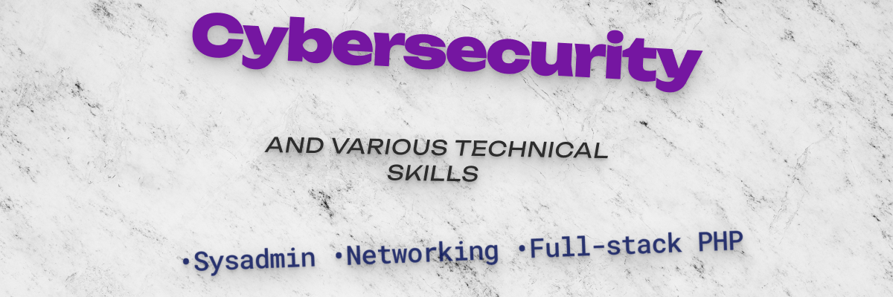

<!-- Верхній банер -->

  

## Привіт! 👋 Мене звати Антон

**Я студент, вивчаю кібербезпеку та основи системного адміністрування.**

Проходжу практичні кімнати та лабораторії на платформах **TryHackMe** та **PortSwigger Web Security Academy**. Цікавлюся веббезпекою, мережами та адмініструванням Linux-серверів.

---

### 🛠️ Навички та інструменти

---

<!-- 

  
    
  

 -->
